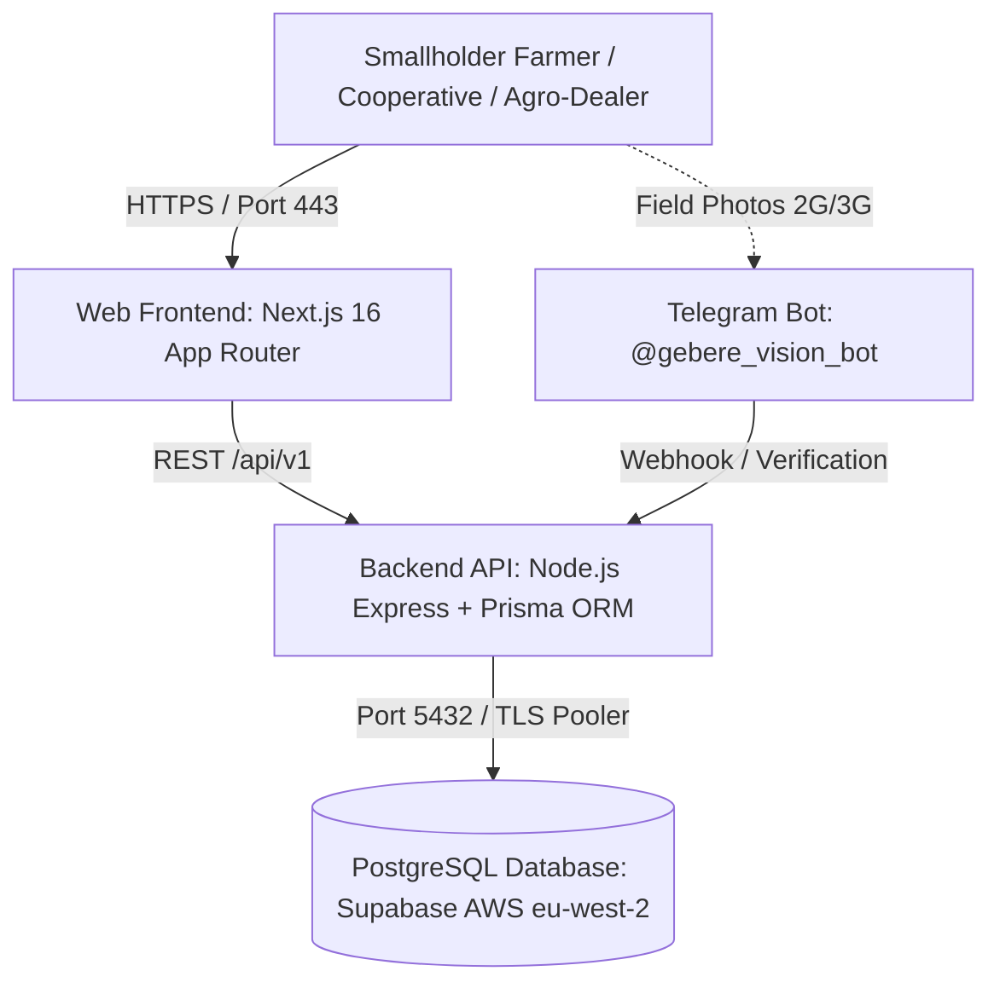

# Oomisha360 — Production Deployment Readiness Guide
**Version:** 1.0.0-production-candidate  
**Date:** October 2026  
**Audience:** Founders, Lead Engineers, DevOps, Pilot Coordinators  

---

## 1. System Architecture & Topology



### Component Inventory
* **Web Frontend (`apps/web`)**: Next.js 16 with Turbopack, Tailwind CSS, Lucide icons, Leaflet mapping.
* **Backend API (`apps/api`)**: Express 4, TypeScript, Prisma ORM, CORS, Helmet, Rate Limiter.
* **Shared Types (`packages/shared`)**: Canonical TypeScript interfaces, land area math, financial engines.
* **Database (`PostgreSQL`)**: Hosted on Supabase Pooler (`aws-0-eu-west-2.pooler.supabase.com:5432`) with 10 tables:
  `User`, `Farm`, `LandRecord`, `Expense`, `Harvest`, `MarketplaceListing`, `MarketplaceInquiry`, `CropProtectionProduct`, `CropProtectionListing`, `CropProtectionInquiry`.

---

## 2. Pre-Flight Verification Audit Results

Before production deployment, all automated tests, builds, and safety guarantees were executed:

| Verification Stage | Command / Target | Result | Production Safe |
|---|---|---|---|
| **Shared Unit Tests** | `npm run test --workspace=packages/shared` | 25/25 Passing | Yes |
| **API Integration Tests** | `node --test apps/api/src/tests/*.cjs` | 64/64 Passing | Yes |
| **Cross-Tenant IDOR Security** | `apps/api/src/tests/auth.test.cjs` | Verified | Yes |
| **Production Demo Rejection** | `NODE_ENV=production` header check | Rejects demo tokens with 401 | Yes |
| **TypeScript Compilation** | `npm run typecheck --workspaces` | 0 errors | Yes |
| **Frontend Linting** | `npm run lint --workspace=apps/web` | 0 errors | Yes |
| **API Production Build** | `npm run build:api` | Clean `apps/api/dist` | Yes |
| **Web Production Build** | `npm run build:web` | 22/22 static routes compiled | Yes |
| **Database Pooler Health** | Port 5432 TLS socket connection | Active (10 tables verified) | Yes |

---

## 3. Production Environment Variables Checklist

Ensure these variables are set in your production hosting dashboards (do not commit secrets to Git):

### A. Frontend (`apps/web`) — e.g. Vercel / Netlify
```bash
# Public URL of your deployed Express API
NEXT_PUBLIC_API_URL=https://api.oomisha360.et/api/v1

# Supabase Auth & Storage Config
NEXT_PUBLIC_SUPABASE_URL=https://<your-project-ref>.supabase.co
NEXT_PUBLIC_SUPABASE_ANON_KEY=eyJhbGciOi...

# Node environment
NODE_ENV=production
```

### B. Backend API (`apps/api`) — e.g. Railway / Render / DigitalOcean
```bash
# Port and runtime
PORT=5000
NODE_ENV=production

# Allowed Web Origins for CORS (comma-separated or single domain)
CORS_ORIGIN=https://oomisha360.et,https://www.oomisha360.et,https://app.oomisha360.et

# Direct/Pooler PostgreSQL connection string
DATABASE_URL="postgresql://postgres.<project-ref>:<password>@aws-0-eu-west-2.pooler.supabase.com:5432/postgres?sslmode=require&supa=base-pooler.x"

# Supabase verification credentials
SUPABASE_URL=https://<your-project-ref>.supabase.co
SUPABASE_ANON_KEY=eyJhbGciOi...
SUPABASE_SERVICE_ROLE_KEY=eyJhbGciOi...

# JWT secret for token fallback
JWT_SECRET=<generated-64-character-random-hex>
```

---

## 4. Step-by-Step Deployment Options

### Option 1: Standard Modern Cloud (Recommended)
1. **Frontend on Vercel**:
   - Connect GitHub repo: `https://github.com/oumersalah2-cmd/Oomisha360.git`.
   - Root Directory: `apps/web`.
   - Framework Preset: `Next.js`.
   - Build Command: `cd ../.. && npm run build --workspace=apps/web`.
   - Output Directory: `.next`.
   - Add environment variables (`NEXT_PUBLIC_API_URL`, `NEXT_PUBLIC_SUPABASE_URL`, `NEXT_PUBLIC_SUPABASE_ANON_KEY`).

2. **Backend API on Railway / Render**:
   - Connect GitHub repo.
   - Root Directory: `apps/api`.
   - Build Command: `npm install && npm run build --workspace=packages/shared && npm run build:api`.
   - Start Command: `node dist/index.js` or `npm run start --workspace=apps/api`.
   - Set environment variables (`NODE_ENV=production`, `DATABASE_URL`, `CORS_ORIGIN`, `SUPABASE_URL`, etc.).

---

### Option 2: Docker / Container Deployment

#### API `Dockerfile` (`apps/api/Dockerfile`):
```dockerfile
FROM node:20-alpine AS builder
WORKDIR /app
COPY package*.json ./
COPY packages/shared/package*.json ./packages/shared/
COPY apps/api/package*.json ./apps/api/
RUN npm ci
COPY packages/shared ./packages/shared
COPY apps/api ./apps/api
RUN npm run build --workspace=packages/shared
RUN npm run build:api

FROM node:20-alpine AS runner
WORKDIR /app
ENV NODE_ENV=production
COPY --from=builder /app/package*.json ./
COPY --from=builder /app/node_modules ./node_modules
COPY --from=builder /app/apps/api/dist ./apps/api/dist
COPY --from=builder /app/packages/shared/dist ./packages/shared/dist
EXPOSE 5000
CMD ["node", "apps/api/dist/index.js"]
```

---

## 5. Crop Diagnosis & Agricultural Safety Policy

When deploying Oomisha360 to real farmers:
1. **Advisory Tool Labeling**: The AI model is prominently labeled as an **Advisory Field Scouting Assistant**.
2. **Non-Prescription Standard**: The application explicitly warns farmers:
   > *"AI diagnoses are indicative preliminary observations. They do not constitute chemical prescriptions. Always confirm diagnoses and economic damage thresholds with your Kebele Agricultural Development Agent (DA) before purchasing or applying synthetic pesticides."*
3. **Escalation Integration**: Every diagnosis card includes a direct `"Request Woreda Agronomist Field Visit"` button, dispatching a localized follow-up request with farmer contact details.

---

## 6. Pilot Launch Protocol (5–10 Farmers)

For your initial pilot cohort:
1. **Pilot Woredas**: Start in 1 or 2 targeted agricultural zones (e.g., Ada'a woreda in East Shewa or Sinana woreda in Bale).
2. **Onboarding Checklist**:
   - Guide the farmer through registering their farm name and choosing their primary crops (Teff, Wheat, Coffee, Barley).
   - Have the farmer measure a field plot using the Land Calculator.
   - Record an initial seasonal expense (e.g. seed or plowing).
   - Record a harvest lot upon maturity.
   - Test language switching between **Afaan Oromoo**, **አማርኛ**, and **English**.
3. **Feedback Capture**:
   - Document whether any button label or input caused confusion.
   - Record feedback on network performance over 2G/3G Safaricom/Ethio Telecom connections.
